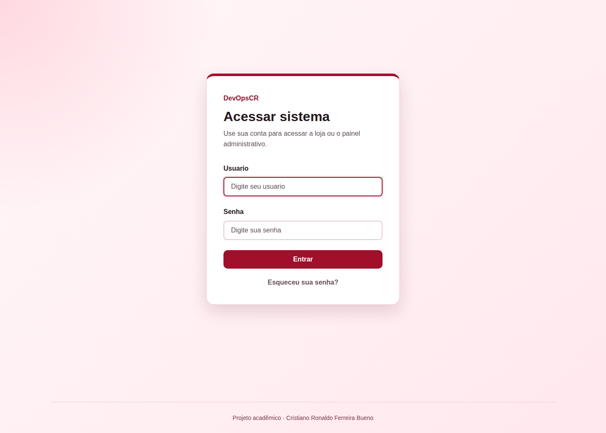
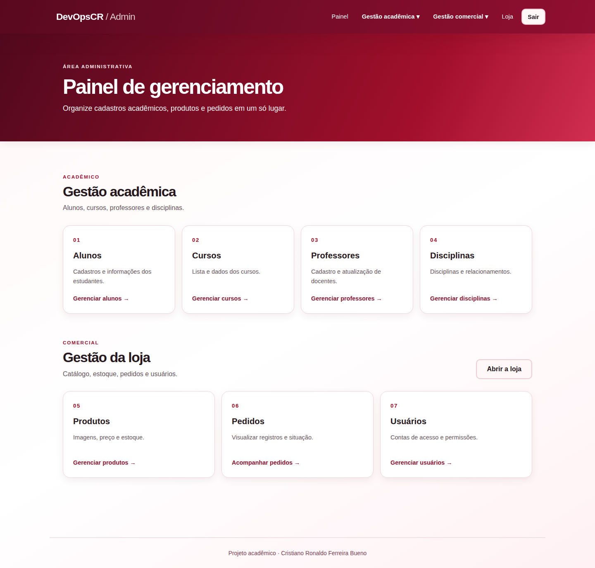
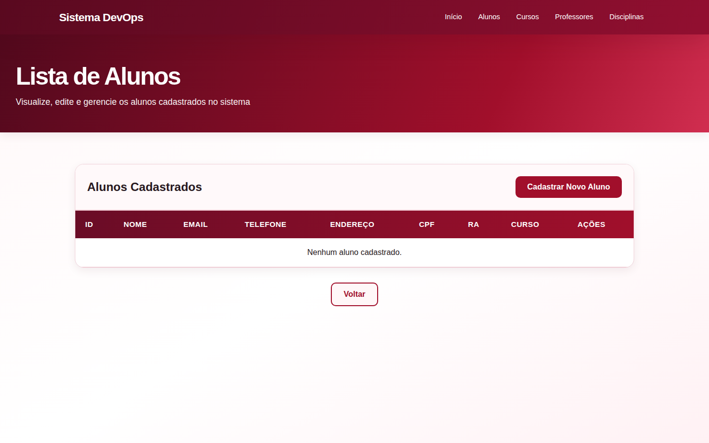
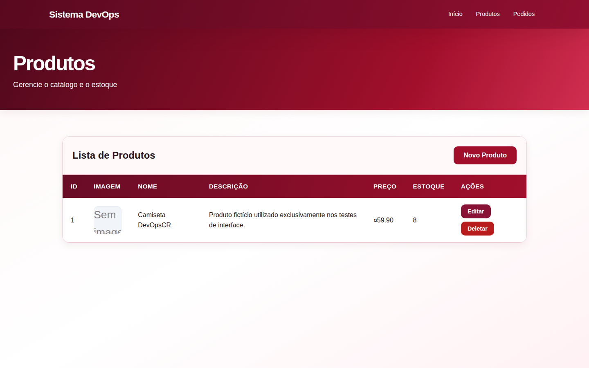
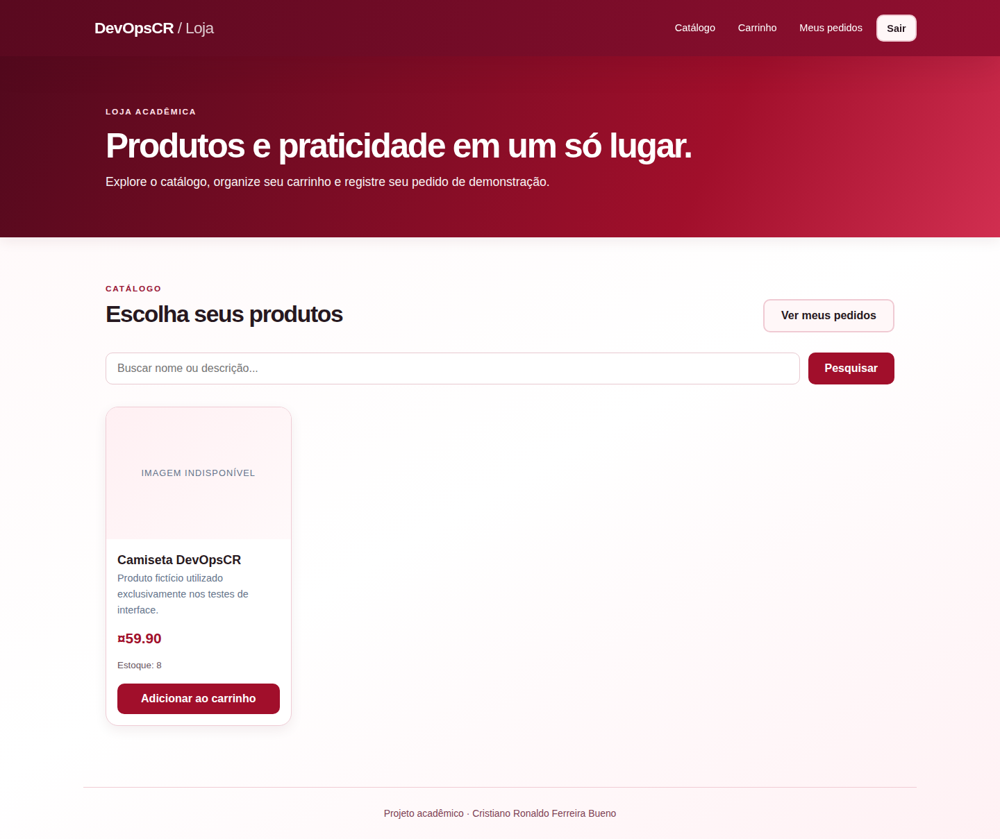
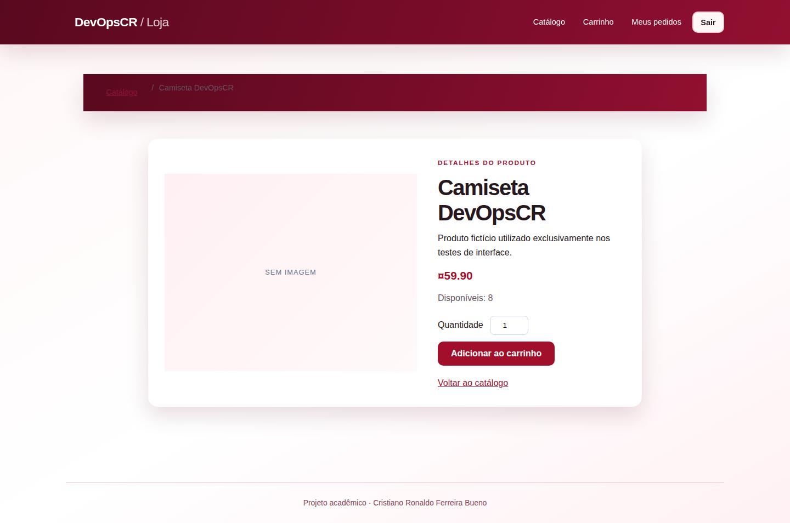
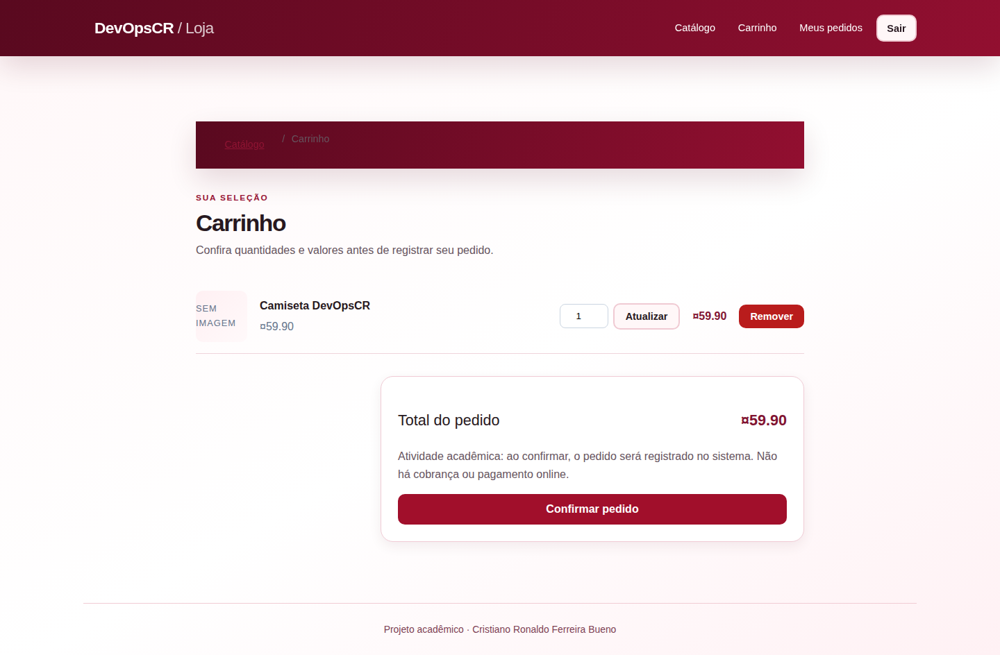
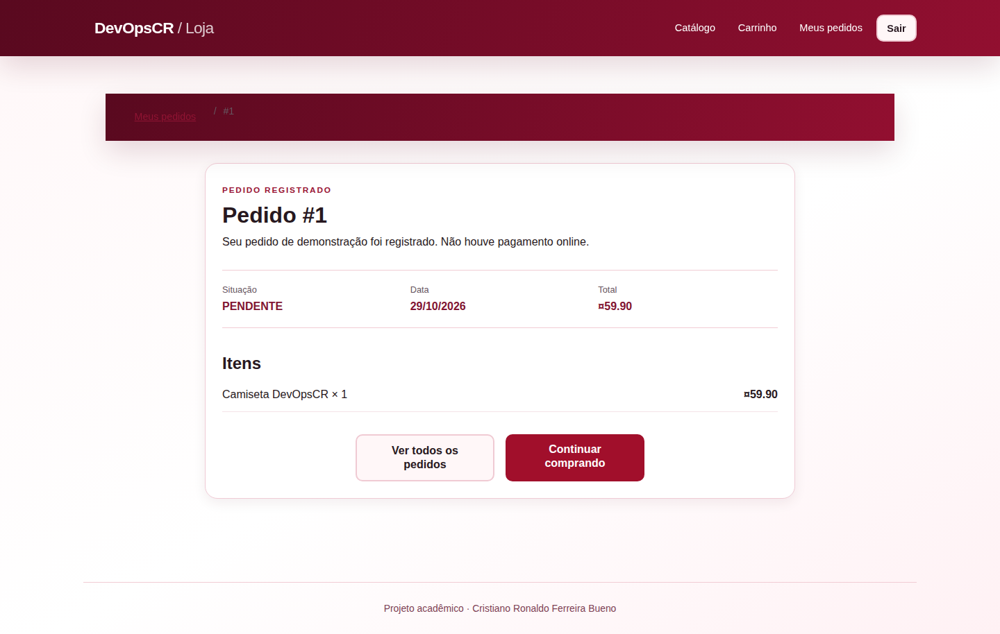
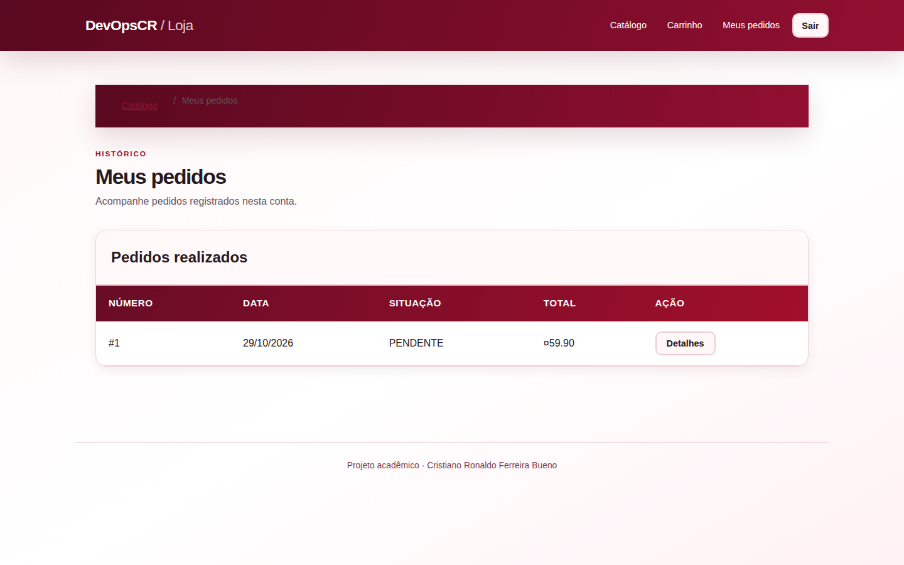

# DevOpsCR — Sistema Acadêmico & Loja de Demonstração

<p align="center">
  
  
  
</p>


> **Autor:** Cristiano Ronaldo Ferreira Bueno  
> Projeto acadêmico para demonstrar desenvolvimento de software em Java, organização MVC, integração de dados relacionais, autenticação e práticas iniciais de DevOps.

## Visão geral

O **DevOpsCR** reúne dois domínios preservados da atividade original: **gestão acadêmica** (alunos, cursos, professores e disciplinas) e **gestão comercial** (catálogo, produtos, estoque, usuários e pedidos). O administrador gerencia ambas as áreas e o cliente autenticado utiliza a loja.

A interface foi organizada com identidade **vermelho profundo, vinho e neutros claros**, componentes responsivos e navegação distinta para clientes e administração.

### Funcionalidades

| Módulo | O que faz |
| --- | --- |
| Login e contas | Spring Security com papéis `USER` e `ADMIN`, senhas BCrypt e recuperação por e-mail quando SMTP configurado |
| Catálogo | Busca, listagem, detalhes, imagem e disponibilidade de produtos |
| Carrinho | Adicionar produtos, alterar quantidades, remover e revisar total |
| Checkout acadêmico | Registra pedido e itens com valores calculados no servidor e validação de estoque |
| Meus pedidos | Histórico e detalhes limitados à conta autenticada |
| Administração comercial | CRUD de produtos, usuários e pedidos com seus itens |
| Administração acadêmica | CRUD de alunos, cursos, professores e disciplinas |

**Atenção:** não existe integração com pagamentos. O botão de confirmação registra um pedido acadêmico, sem cobrança financeira.

## Arquitetura e tecnologias reais

- **Java 17**, **Spring Boot 4.0.3** e Spring MVC — regras e controladores da aplicação.
- **Thymeleaf**, HTML, CSS e JavaScript — páginas renderizadas no servidor.
- **Spring Data JPA / Hibernate** — relacionamentos e operações no banco de dados.
- **Spring Security** e BCrypt — autenticação e autorização por perfil.
- **PostgreSQL** — banco de dados principal configurado em `application.properties`.
- **H2** — banco em memória configurado para os testes.
- **Maven Wrapper** — dependências, compilação e testes reproduzíveis.
- **JUnit 5/Mockito** — testes automatizados.
- **Git e GitHub Actions** — versionamento e execução da verificação Maven.

### Fluxo entre camadas

```text
Requisição HTTP / formulário HTML
             │
             ▼
Controller (rotas e navegação)
             │
             ▼
Service (validação e regras do sistema)
             │
             ▼
Repository (Spring Data JPA)
             │
             ▼
Entity (modelo) ── Banco PostgreSQL / H2 de testes
```

Por exemplo, `LojaController` recebe a solicitação de finalização, `CheckoutService` confere existência de produtos e estoque em transação e `PedidoRepository` grava o pedido com `ItemDoPedido`. O preço final vem do banco, não de dados enviados pelo navegador.

A implementação usa identificador único de tentativa para minimizar pedidos duplicados. O estoque do checkout utiliza bloqueio pessimista para reduzir condições de corrida entre compras concorrentes.

## Capturas do sistema

Capturas reais produzidas automaticamente com Spring Boot e H2 em uma execução de teste, utilizando contas e produtos fictícios.

### Login e autenticação



### Painel administrativo



### Gestão acadêmica



### Cadastro de produtos



### Catálogo da loja



### Detalhes de produto



### Carrinho de compras



### Confirmação de pedido



### Histórico de pedidos



## Como executar no computador

**Pré-requisitos:** JDK 17, PostgreSQL e acesso ao Maven Central na primeira compilação.

1. Clone o repositório:
   ```bash
   git clone https://github.com/CristianoRFB/devopscr.git
   cd devopscr/devops
   ```
2. No PostgreSQL, crie `devops_db`, ou use outro banco compatível configurado em `DB_URL`.
3. Configure as variáveis de ambiente `DB_URL`, `DB_USERNAME` e `DB_PASSWORD`. O valor padrão de `DB_URL` é `jdbc:postgresql://localhost:5432/devops_db`. **Não grave sua senha no Git.**
4. Execute no Linux/macOS:
   ```bash
   ./mvnw spring-boot:run
   ```
   No Windows, use `mvnw.cmd spring-boot:run`.
5. Abra `http://localhost:8080`.

### Contas locais para demonstração

O inicializador `UsuarioPadraoInitializer` atua **somente** com perfil Spring `dev`, com senhas definidas fora do repositório. Para habilitá-lo, configure:

```text
SPRING_PROFILES_ACTIVE=dev
DEV_ADMIN_PASSWORD=defina_uma_senha_local_forte
DEV_USER_PASSWORD=defina_outra_senha_local_forte
```

Esses são **exemplos de configuração**, não credenciais válidas publicadas. O inicializador não substitui a senha de contas já existentes. Para recuperação de senha por e-mail, informe `MAIL_USERNAME`, `MAIL_PASSWORD` e `APP_BASE_URL`.

## Testes e pipeline

Na pasta `devops/`:

```bash
./mvnw -B clean verify
```

O projeto inclui um teste de inicialização do contexto, testes do `PedidoService` e testes unitários do `CheckoutService` (total, estoque, validação de quantidade e duplicidade). Consulte [workflow Java CI](.github/workflows/java-ci.yml) para a configuração que roda em push e pull request.

O badge de Actions reflete o resultado que o próprio GitHub publica; **não há garantia de que o pipeline esteja verde sem checá-lo**. Execute também as verificações manuais do roteiro em [docs/AUDITORIA.md](docs/AUDITORIA.md).

## Organização dos arquivos

```text
.
├── .github/workflows/java-ci.yml   # Build e testes
├── README.md
├── docs/
│   ├── AUDITORIA.md                 # Problemas, correções e limites
│   └── screenshots/                # Orientações para prints reais
└── devops/
    ├── pom.xml
    ├── mvnw / mvnw.cmd
    └── src/
        ├── main/java/br/com/devops/devops/
        │   ├── config/             # Inicialização DEV
        │   ├── controller/         # Endpoints MVC
        │   ├── entity/             # Mapeamento JPA
        │   ├── repository/         # Acesso aos dados
        │   ├── security/           # Spring Security
        │   └── service/            # Regras de negócio
        ├── main/resources/
        │   ├── templates/          # Telas e fragments Thymeleaf
        │   ├── static/css/         # Design system vermelho
        │   └── application.properties
        └── test/                   # JUnit e banco H2
```

## Decisões de desenvolvimento e segurança

O código demonstra POO, encapsulamento, MVC, CRUD, validação, persistência relacional, associação de entidades, sessões HTTP, autenticação e autorização, tratamento básico de erros e automação de build.

- O CSRF permanece habilitado para proteger ações que modificam dados.
- Exclusões administrativas utilizam `POST`, não acessos diretos por link GET.
- O acesso à administração exige papel `ADMIN`.
- A finalização utiliza transação e preços consultados novamente no banco.
- Contas de demonstração não têm senha fixa versionada.
- O sistema não registra tokens de recuperação de senha em logs.
- Dados acadêmicos e comerciais permanecem separados na navegação, preservando o escopo da atividade.

### Limitações reais

É uma aplicação acadêmica, **não preparada para produção**: ainda exige validação com banco PostgreSQL real, teste manual de formulários e acessibilidade, revisão de relacionamentos entre registros que podem ser excluídos e política de estoque para edição administrativa de pedidos. O esquema usa `ddl-auto=update` e não há migrações versionadas de produção. Não há Docker, Kubernetes, nuvem ou gateway de pagamentos.

---

**Cristiano Ronaldo Ferreira Bueno**  
Desenvolvimento acadêmico · DevOpsCR
